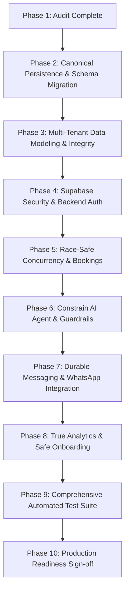

# DeskOS — Comprehensive Production Readiness Audit & Remediation Plan

**Date**: 26 October 2026  
**Auditor**: Senior SaaS Architect, Database Specialist, Application Security Reviewer  
**Scope**: Full-Stack Architecture, Database Persistence (PostgreSQL/Supabase), Multi-Tenant Isolation, Concurrency Safety, AI Agent Guardrails, WhatsApp Integration, Operational Reliability  
**Target Application**: DeskOS (Universal Multi-Industry Appointment & AI Receptionist Engine)

---

## 1. Executive Summary & Production Readiness Scorecard

DeskOS has established a responsive, clean, high-contrast monochrome Next.js frontend, an extensible FastAPI backend structure, and integration with Groq LPUs (`llama-3.3-70b-versatile`, `whisper-large-v3`). The UI and basic simulated user journeys function smoothly in local standalone testing.

However, an in-depth audit reveals that **the platform is not currently production-ready, safe under concurrency, nor secure for multi-tenant SaaS operation**. 

### Critical Audit Highlights
1. **Zero Database Persistence in Practice**: While `supabase_schema.sql` defines tables, the remote Supabase project is missing tables (`universal_businesses`, `universal_bookings`) and missing columns (`bookings.patient_name`, `bookings.client_name`, `bookings.phone`, `bookings.service`). All write operations in `supabase_client.py` fail with PostgREST errors (`PGRST205`, `PGRST204`, `42501`) and silently fallback to Python memory dictionaries (`_memory_conversations`, `_memory_messages`, `_memory_bookings`, `_memory_universal_businesses`). **Every restart or horizontal worker scale-out destroys all customer bookings, chats, and configurations.**
2. **Severe Booking Concurrency Race Conditions (TOCTOU)**: Availability checks in `check_slot_available` perform substring matching in Python memory over free-form text strings (e.g., `"Today, 02:30 PM"`). Concurrent requests for the same slot both pass and insert conflicting records. There are no PostgreSQL exclusion constraints, locks, transactions, or parsed `TIMESTAMPTZ` intervals.
3. **No Authentication, Authorization, or Tenant Isolation**: FastAPI endpoints have zero authentication (no JWT, API key, or session validation). Any anonymous caller can query or mutate any tenant's data by passing `?business_id=target_business` or omitting it entirely (defaulting to `"default_business"`). `conversations` globally keys on `wa_user_id` without scoping to a business.
4. **False Confirmation Bug in AI Agent**: If Groq LPU fails on the post-tool reasoning step, `core.py` (lines 291–292) falsely confirms to the user that their appointment is booked, even when the booking tool returned `overlap: True` and failed.
5. **Fabricated Analytics & Destructive Presets**: Dashboard metrics contain hardcoded arithmetic multipliers (e.g., `total_leads * 24 + 120`), and switching industry presets completely overwrites all customized services, opening hours, and FAQs.

### Production Readiness Scorecard

| Domain | Status | Severity | Summary |
| :--- | :---: | :---: | :--- |
| **Persistence Layer** | 🔴 Critical | High Data Loss Risk | Silent in-memory fallbacks masking remote RLS and schema mismatches. |
| **Concurrency & Booking Safety** | 🔴 Critical | High Conflict Risk | No DB-level slot locking, substring matching on free-form time strings. |
| **Authentication & AuthZ** | 🔴 Critical | Data Leakage / Compromise | Zero endpoint protection; tenant ID client-controlled with default fallbacks. |
| **Supabase & RLS Security** | 🔴 Critical | Vulnerability | Wildcard RLS policies in SQL; frontend anon key has unfiltered access if applied. |
| **AI Agent Guardrails** | 🟠 High | False Confirmations | Hallucinated confirmations on error; hardcoded IST timezone (+05:30). |
| **Messaging & WhatsApp** | 🟠 High | Delivery Mismatch | No retry queue, single-tenant credentials, status returned as 'sent' even on failure. |
| **Analytics & Data Integrity** | 🟡 Medium | Fabricated Numbers | Fake multipliers and static SVG charts instead of event-driven metrics. |
| **Code Architecture & Design** | 🟢 Pass | Verified Sound | Clean UI system, modular routers, functional LPU tool-calling loop, audio handling. |

---

## 2. Detailed Findings by Category

### Category A: Database Persistence & Storage Architecture

#### Finding A.1: Silent In-Memory Fallbacks Masking Persistent Database Failures
- **Severity**: **CRITICAL**
- **File / Location**: `backend/app/services/supabase_client.py` (`get_or_create_conversation`, `get_conversation`, `list_conversations`, `save_message`, `get_recent_messages`, `create_universal_booking`, `list_universal_bookings`, `get_universal_business`, `update_universal_business`)
- **Evidence**:
  ```python
  # Lines 21-25
  _memory_conversations: Dict[str, Dict[str, Any]] = {}
  _memory_messages: List[Dict[str, Any]] = []
  _memory_bookings: List[Dict[str, Any]] = []

  # Lines 486-488 & 507-511
  except Exception as e:
      logger.warning("Supabase universal_bookings insert failed (%s). Retrying legacy bookings...", e)
  # ...
  except Exception as e2:
      logger.warning("Supabase bookings table fallback insert error: %s", e2)
  _memory_bookings.append(record)
  return record
  ```
- **Reproduction / Live Test**:
  Executed against remote Supabase:
  - `POST /rest/v1/universal_bookings` returned `404 Not Found (code: PGRST205: Could not find table 'universal_bookings')`.
  - Fallback `POST /rest/v1/bookings` returned `400 Bad Request (code: 42703: column bookings.patient_name does not exist)`.
  - The booking was stored in `_memory_bookings`. Upon restarting the Python process, querying `/api/bookings` returned an empty list.
- **Impact**: Zero durability. Data silently disappears on server restart, crash, or horizontal scaling (multi-worker uvicorn instances do not share memory).
- **Migration Required**: Yes. Establish a single canonical database schema and remove silent in-memory fallback writes. Backend operations must raise explicit errors if database persistence fails.

---

#### Finding A.2: Remote Supabase Schema Drastically Out of Sync with Code and `supabase_schema.sql`
- **Severity**: **CRITICAL**
- **File / Location**: Remote Supabase DB vs `supabase_schema.sql`
- **Evidence**:
  Live schema probe results:
  - `universal_businesses`: **Does not exist** (`PGRST205`).
  - `universal_bookings`: **Does not exist** (`PGRST205`).
  - `bookings`: Exists, but only has columns `[id, slot_time, service_type, created_at, business_id, conversation_id]`. Columns `patient_name`, `client_name`, `phone`, `service`, `status` **do not exist** (`42703`).
  - `business_configs`: Exists with legacy schema, but `anon` role has no INSERT/UPDATE privileges (`code: 42501 RLS violation`).
  - `conversations`: Exists, but `anon` role INSERT fails (`code: 42501 RLS violation`).
- **Impact**: The application cannot write to the database at all in its current remote state.
- **Migration Required**: Yes. A versioned, idempotent PostgreSQL migration must be executed to reconcile tables, columns, and foreign keys.

---

#### Finding A.3: Conflicting Dual-Table Read/Write Paths
- **Severity**: **HIGH**
- **File / Location**: `backend/app/services/supabase_client.py` (lines 463–511, 532–584, 587–680)
- **Evidence**:
  - `create_universal_booking` writes to `universal_bookings`, falls back to `bookings`, then falls back to memory.
  - `list_universal_bookings` reads `universal_bookings`, and if empty, reads `bookings`, and then merges in-memory items.
  - `update_universal_business` updates `universal_businesses` and duplicates data into `business_configs`.
- **Impact**: Data fragmentation, sync race conditions, split-brain state between legacy and universal tables, untraceable inconsistencies.
- **Migration Required**: Yes. Deprecate legacy dual-writes; establish `businesses` and `bookings` as the sole canonical tables.

---

#### Finding A.4: Unnormalized JSONB Monolithic Catalogs
- **Severity**: **MEDIUM**
- **File / Location**: `supabase_schema.sql` (lines 68–70, 85–88), `supabase_client.py`
- **Evidence**:
  Entire service catalogs (`services JSONB DEFAULT '[]'::jsonb`), operating hours (`operating_hours JSONB`), FAQs (`faqs JSONB`), and escalation rules (`escalation_rules JSONB`) are stored as JSON blobs inside a single business row.
- **Impact**:
  - Updating a single service price requires rewriting the entire JSON array.
  - No database-level validation of service price, duration, or active status.
  - Cannot enforce foreign key constraints between a booking and the service requested (`bookings.service` is a loose text string).
  - Race conditions when two operators edit services or hours concurrently (last write wins, overwriting the other's edits).
- **Migration Required**: Yes. Normalize `services` and `operating_hours` into relational tables with foreign keys and check constraints.

---

### Category B: Multi-Tenant Data Isolation & Security

#### Finding B.1: Absence of Authentication and Authorization on Backend APIs
- **Severity**: **CRITICAL**
- **File / Location**: `backend/app/api/business.py`, `backend/app/api/desk.py`, `backend/app/api/webhook.py`
- **Evidence**:
  - `GET /api/business/config?business_id=...`: No auth dependency, no session check.
  - `PUT /api/business/config?business_id=...`: Any public caller can overwrite business settings.
  - `GET /api/conversations`: Returns all conversations across all businesses without tenant filtering.
  - `GET /api/conversations/{conv_id}/messages`: Any caller can read chat logs for any conversation.
  - `POST /api/messages/manual`: Any caller can send an outbound WhatsApp message to any phone number.
  - `GET /api/bookings?business_id=...`: Unauthenticated access to full customer appointment records.
- **Impact**: Immediate data breach vulnerability (OWASP API1:2023 Broken Object Level Authorization, OWASP API2:2023 Broken Authentication). Anyone on the network can exfiltrate customer PII or hijack communication.
- **Migration Required**: No (Backend application security layer with JWT/Session authentication and tenant membership enforcement).

---

#### Finding B.2: Insecure Row-Level Security (RLS) in `supabase_schema.sql`
- **Severity**: **CRITICAL**
- **File / Location**: `supabase_schema.sql` (lines 112–141)
- **Evidence**:
  ```sql
  CREATE POLICY "Allow anon and auth all access to universal_businesses" 
      ON public.universal_businesses FOR ALL TO anon, authenticated USING (true) WITH CHECK (true);
  CREATE POLICY "Allow anon and auth all access to universal_bookings" 
      ON public.universal_bookings FOR ALL TO anon, authenticated USING (true) WITH CHECK (true);
  CREATE POLICY "Allow anon and auth all access to conversations" 
      ON public.conversations FOR ALL TO anon, authenticated USING (true) WITH CHECK (true);
  CREATE POLICY "Allow anon and auth all access to chat_messages" 
      ON public.chat_messages FOR ALL TO anon, authenticated USING (true) WITH CHECK (true);
  ```
- **Impact**: If applied as written, any user possessing the frontend `NEXT_PUBLIC_SUPABASE_ANON_KEY` can execute direct SQL queries/mutations against Supabase to view, alter, or delete all records of all businesses.
- **Migration Required**: Yes. Restrict direct Supabase access, scope RLS to authenticated user memberships, or restrict direct database operations to the backend service role.

---

#### Finding B.3: Global `wa_user_id` Collision Across Tenants in `conversations`
- **Severity**: **HIGH**
- **File / Location**: `supabase_schema.sql` (line 9), `backend/app/services/supabase_client.py` (line 37)
- **Evidence**:
  ```sql
  CREATE TABLE IF NOT EXISTS public.conversations (
      id UUID PRIMARY KEY DEFAULT gen_random_uuid(),
      wa_user_id TEXT UNIQUE NOT NULL,
      ...
  );
  ```
  `conversations` enforces `wa_user_id TEXT UNIQUE` globally, with no `business_id` scoping!
- **Impact**: If Customer X (`+919876543210`) contacts Business A (e.g., a dental clinic) and later contacts Business B (e.g., an auto garage), Business B will load Customer X's existing conversation with Business A. Medical chat history and confidential messages would be exposed to the auto mechanic.
- **Migration Required**: Yes. Alter `conversations` to enforce composite uniqueness: `UNIQUE(business_id, wa_user_id)`.

---

#### Finding B.4: Hardcoded Tenant IDs & Default Business Overwrites
- **Severity**: **HIGH**
- **File / Location**: `supabase_client.py` (lines 644–647), `frontend/src/lib/api.ts` (lines 189, 197, 210, 221)
- **Evidence**:
  ```python
  # supabase_client.py
  _memory_universal_businesses[business_id] = updated
  _memory_universal_businesses["default_business"] = updated
  _memory_universal_businesses["default_clinic"] = updated
  ```
- **Impact**: Mutating any business configuration overwrites the global `"default_business"` and `"default_clinic"`. The frontend defaults to `"default_business"` on every page.
- **Migration Required**: No (Code fix to require explicit tenant routing via authenticated context or URL slug).

---

### Category C: Appointment Scheduling & Concurrency Safety

#### Finding C.1: Time-of-Check to Time-of-Use (TOCTOU) Race Conditions
- **Severity**: **CRITICAL**
- **File / Location**: `backend/app/services/supabase_client.py` (lines 410–443), `backend/app/agent/tools.py` (lines 104–125)
- **Evidence**:
  ```python
  def check_slot_available(slot_time: str, business_id: str = "default_business") -> bool:
      # Step 1: Reads all bookings from DB/memory
      bookings = list_universal_bookings(business_id)
      # Step 2: Checks in python loop
      for b in bookings: ...
      return True

  # In create_universal_booking:
  if not force and not check_slot_available(slot_time, business_id):
      raise ValueError(...)
  # Step 3: Separate insert into DB
  res = supabase.table("universal_bookings").insert(...).execute()
  ```
- **Reproduction**: If two callers request `"Tomorrow 4 PM"` at the same time:
  1. Request A calls `check_slot_available("Tomorrow 4 PM")` -> `True`.
  2. Request B calls `check_slot_available("Tomorrow 4 PM")` -> `True`.
  3. Request A inserts booking -> Success.
  4. Request B inserts booking -> Success.
  Both bookings are confirmed for the exact same staff member and slot.
- **Impact**: Double bookings, provider scheduling conflicts, lost business reputation.
- **Migration Required**: Yes. Must use PostgreSQL database transactions, explicit row locking (`SELECT FOR UPDATE`), or PostgreSQL range exclusion constraints (`EXCLUDE USING gist (provider_id WITH =, slot_range WITH &&)`).

---

#### Finding C.2: Naive Substring Overlap Check Logic
- **Severity**: **HIGH**
- **File / Location**: `backend/app/services/supabase_client.py` (lines 419–422)
- **Evidence**:
  ```python
  if existing_time and (existing_time == clean_target or clean_target in existing_time or existing_time in clean_target):
      return False
  ```
- **Impact**:
  - False Positives: `"2 PM"` matches `"12 PM"` (`"2 pm" in "12 pm"` is True) -> legitimate 12 PM booking is blocked because someone booked 2 PM!
  - False Positives: `"10"` matches `"10:30"` -> blocks 10:30 slot.
  - False Negatives: `"Tomorrow at 3pm"` does not match `"Saturday at 15:00"` or `"26 Oct 3:00 PM"`. Two clients booking the identical hour with different phrasing will not be detected as an overlap.
- **Migration Required**: Yes. Store start time and end time as exact `TIMESTAMPTZ` columns; resolve natural language to structured timestamps before checking availability.

---

#### Finding C.3: Free-Form Text for Slot Times Without Timezone Information
- **Severity**: **HIGH**
- **File / Location**: `supabase_schema.sql` (lines 47, 99), `tools.py`, `core.py`
- **Evidence**:
  `slot_time TEXT NOT NULL` stores arbitrary conversational text: `"Today, 02:30 PM"`, `"Tomorrow afternoon"`, `"Next Monday morning"`.
- **Impact**:
  - Impossibility of automated calendar export (.ics), reminders, or timezone offsets.
  - As time elapses, `"Today, 02:30 PM"` remains `"Today"` indefinitely in past records.
- **Migration Required**: Yes. Replace `slot_time TEXT` with `start_time TIMESTAMPTZ NOT NULL`, `end_time TIMESTAMPTZ NOT NULL`, and `timezone TEXT NOT NULL`.

---

### Category D: AI Agent Reliability & Guardrails

#### Finding D.1: Hallucinated Appointment Confirmation on Model Post-Tool Failure
- **Severity**: **CRITICAL**
- **File / Location**: `backend/app/agent/core.py` (lines 280–294)
- **Evidence**:
  ```python
  try:
      second_resp = client.chat.completions.create(...)
      final_reply = second_resp.choices[0].message.content or ""
  except Exception as e:
      logger.error("Failed to generate post-tool response: %s", e)
      if any(t["name"] in ("check_and_book_appointment", "book_appointment") for t in executed_tools):
          final_reply = "Your appointment has been successfully scheduled! You will receive confirmation details shortly."
  ```
- **Impact**: If a client requests a slot that was **rejected due to an overlap conflict** (`success: False, overlap: True`), and Groq throws a rate-limit or network timeout on the second call, the exception handler fires. It checks if `check_and_book_appointment` was *executed* (which it was!), completely ignores that it *failed*, and falsely tells the customer: `"Your appointment has been successfully scheduled!"`
- **Migration Required**: No (Immediate code logic fix in `core.py`).

---

#### Finding D.2: Non-Existent Models in Candidate Fallback List
- **Severity**: **MEDIUM**
- **File / Location**: `backend/app/agent/core.py` (lines 13–19)
- **Evidence**:
  ```python
  MODEL_CANDIDATES = [
      GROQ_CHAT_MODEL,
      "llama-3.3-70b-versatile",
      "openai/gpt-oss-120b",
      "qwen/qwen3.8-27b",
      "openai/gpt-oss-20b"
  ]
  ```
  `openai/gpt-oss-120b`, `qwen/qwen3.8-27b`, and `openai/gpt-oss-20b` are not valid Groq-hosted model identifiers.
- **Impact**: When fallback is triggered, Groq returns `400 Bad Request / ModelNotFoundError`, cascading into total failure (`RuntimeError: All Groq models failed`).
- **Migration Required**: No (Update list to valid Groq models: `llama-3.3-70b-versatile`, `llama-3.1-8b-instant`, etc.).

---

#### Finding D.3: Hardcoded Indian Standard Time (IST) in System Prompt
- **Severity**: **MEDIUM**
- **File / Location**: `backend/app/agent/core.py` (lines 30–33)
- **Evidence**:
  ```python
  ist_tz = timezone(timedelta(hours=5, minutes=30))
  now_ist = datetime.now(ist_tz)
  ```
- **Impact**: Any business located in the UK, US, Europe, Middle East, or East Asia will have their opening hours, date calculations, and holiday closures evaluated against Indian Standard Time.
- **Migration Required**: No (Fetch timezone from the business configuration).

---

### Category E: WhatsApp Messaging & Integration Reliability

#### Finding E.1: Missing Multi-Tenant WhatsApp Phone Routing in Inbound Webhook
- **Severity**: **HIGH**
- **File / Location**: `backend/app/api/webhook.py` (lines 41–56, 99–103)
- **Evidence**:
  In `process_incoming_whatsapp_message`:
  ```python
  sender_phone = message_data.get("from")
  conv = supabase_client.get_or_create_conversation(sender_phone)
  # ...
  agent_result = await core.run_agent_workflow(
      conversation_id=conv_id,
      wa_user_id=sender_phone,
      user_text=user_text
      # business_id is omitted! Defaults to "default_business"
  )
  ```
  In Meta Cloud API payloads, `value["metadata"]["phone_number_id"]` identifies the recipient WhatsApp Business Account. The code ignores this field and defaults every incoming message to `"default_business"`.
- **Impact**: A single deployment cannot serve multiple businesses on WhatsApp.
- **Migration Required**: Yes. Add `phone_number_id` mapping to `businesses` table.

---

#### Finding E.2: False Delivery State Reported to Frontend
- **Severity**: **MEDIUM**
- **File / Location**: `backend/app/api/desk.py` (lines 99–109), `backend/app/services/meta.py` (lines 16–18, 48–55)
- **Evidence**:
  ```python
  meta_result = await meta.send_whatsapp_message(...)
  return {
      "status": "sent",
      "message": saved,
      "meta_response": meta_result
  }
  ```
  If Meta credentials are missing or the API returns HTTP 400/500, `send_whatsapp_message` returns `status: "skipped"` or `"error"`, but `desk.py` still returns `status: "sent"` to the frontend.
- **Impact**: Operators believe messages were delivered when they failed or were never dispatched.
- **Migration Required**: No. Explicit message status tracking (`queued`, `sent`, `delivered`, `failed`).

---

#### Finding E.3: No Durable Message Queue or Delivery Status Webhooks
- **Severity**: **MEDIUM**
- **File / Location**: `backend/app/api/webhook.py`, `backend/app/services/meta.py`
- **Evidence**:
  Outbound messages are sent directly inline with HTTP requests. There is no job queue, no retry policy with exponential backoff, and no handler for Meta `status` callbacks (`delivered`, `read`, `failed`).
- **Impact**: Transient network glitches result in lost messages with no recovery.
- **Migration Required**: Yes. Create a `message_jobs` table to record delivery attempts and statuses.

---

### Category F: Analytics & Dashboard Metrics

#### Finding F.1: Hardcoded Fabricated Multipliers and Conversion Percentages
- **Severity**: **HIGH**
- **File / Location**: `frontend/src/app/page.tsx` (lines 427, 492, 523), `frontend/src/app/analytics/page.tsx` (lines 49, 60, 70, 79, 99–103, 131–134)
- **Evidence**:
  ```tsx
  // page.tsx
  {analytics?.total_leads ? `${analytics.total_leads * 24 + 120}` : "1,248"}
  {analytics?.conversion_rate ? `${analytics.conversion_rate}%` : "94.2%"}
  
  // analytics/page.tsx
  {data?.total_leads ? `${data.total_leads * 24 + 120}` : "1,248"}
  {data?.booked_count ? `${data.booked_count * 12 + 48}` : "384"}
  {data?.conversion_rate ? `${data.conversion_rate}%` : "30.8%"}
  <div className="mt-2 text-2xl font-bold text-zinc-900">94.2%</div>
  ```
  Static SVG graph lines and fake conversion funnels are rendered regardless of actual data.
- **Impact**: Complete misrepresentation of business performance. Violates SaaS integrity.
- **Migration Required**: No (Calculate actual metrics from real database event logs, and render clean zero/empty states when fresh).

---

#### Finding F.2: Preset Switching Overwrites Existing Custom Services and Hours
- **Severity**: **HIGH**
- **File / Location**: `backend/app/services/supabase_client.py` (lines 686–696), `backend/app/api/business.py` (lines 119–134)
- **Evidence**:
  `apply_industry_preset` takes a static dictionary from `INDUSTRY_PRESETS` and calls `update_universal_business`, completely overwriting `business_name`, `services`, `operating_hours`, `faqs`, and `escalation_rules`.
- **Impact**: If a business owner customizes their services, operating hours, and FAQs, and later switches industry presets or adjusts terminology, all custom work is silently wiped out.
- **Migration Required**: No. Presets should only serve as initial onboarding seeds, or allow terminology-only updates without destroying catalogs.

---

### Category G: Environment & Deployment Hygiene

#### Finding G.1: Wildcard CORS with `allow_credentials=True`
- **Severity**: **MEDIUM**
- **File / Location**: `backend/app/main.py` (lines 25–31)
- **Evidence**:
  ```python
  app.add_middleware(
      CORSMiddleware,
      allow_origins=["*"],
      allow_credentials=True,
      allow_methods=["*"],
      allow_headers=["*"],
  )
  ```
- **Impact**: Invalid CORS configuration according to W3C standards (browsers reject wildcard origins when credentials are true) and security vulnerability if deployed to production.
- **Migration Required**: No (Configure explicit allowed origin list via environment variables).

---

#### Finding G.2: Missing Root `.gitignore` and `.env.example`
- **Severity**: **MEDIUM**
- **File / Location**: Repository root
- **Evidence**:
  Only `frontend/.gitignore` exists. The root directory contains `.env` with live keys, but lacks a root `.gitignore` and `.env.example`.
- **Impact**: Accidental commit of live API keys to version control.
- **Migration Required**: No (Add root `.gitignore` and sanitized `.env.example`).

---

## 3. Verified Already-Correct & Working Components

The audit verified several strong, well-architected aspects that should be preserved:
1. **Frontend Visual System**: The clean, high-contrast monochrome design system (`#FFFFFF` background, `#09090B` text, `#E4E4E7` borders, solid black action buttons) is modular, fully responsive, and builds with **0 TypeScript errors**.
2. **Groq Tool-Calling Loop**: `backend/app/agent/core.py` successfully constructs function schemas (`AGENT_TOOLS_SPEC`), dispatches to `execute_tool_call`, and manages the multi-turn conversational loop.
3. **Voice Note Transcription Pipeline**: `backend/app/services/audio.py` correctly passes binary audio streams to Groq `whisper-large-v3` with graceful fallback to `whisper-large-v3-turbo`.
4. **Idempotency Header Concept**: `supabase_schema.sql` properly indexes `meta_message_id` with a unique index, and `webhook.py` checks idempotency before executing background tasks.
5. **HMAC-SHA256 Webhook Verification**: `backend/app/api/webhook.py` implements standard Meta signature verification using `hmac.compare_digest`.
6. **Unified Launcher**: `start_all.bat` correctly spins up both the FastAPI backend and Next.js frontend concurrently.

---

## 4. Phase-by-Phase Remediation Roadmap



### Stage A: Canonical Persistence & Schema Migration (Phases 2 & 3)
1. **Prepare Versioned Migration**:
   - Create unified tables: `businesses`, `business_users`, `services`, `operating_hours`, `appointments`, `conversations`, `chat_messages`, `message_jobs`.
   - Add proper PostgreSQL data types (`TIMESTAMPTZ`, foreign keys with `ON DELETE CASCADE / RESTRICT`, integer minor currency units or exact `NUMERIC(10,2)`).
   - Add range exclusion constraints (`tsrange`/`tstzrange`) for slot overlap prevention.
2. **Eliminate In-Memory Fallbacks**:
   - Remove silent try-except fallback dictionaries in `supabase_client.py`.
   - Fail fast with clear error logging if database connection is unavailable.
3. **Multi-Tenant Scoping**:
   - Composite unique key: `conversations(business_id, wa_user_id)`.
   - Every read and write explicitly filtered by authenticated `business_id`.

### Stage B: Security & Authentication (Phase 4)
1. **Backend Authentication Layer**:
   - Implement bearer token / API key verification dependency in FastAPI for administrative and support desk endpoints.
   - Restrict Supabase write access to server-side client using `SUPABASE_SERVICE_ROLE_KEY` (never exposed to frontend).
2. **Hardened RLS Policies**:
   - Revoke public anonymous write privileges.
   - Enforce tenant isolation policies.

### Stage C: Concurrency & Booking Safety (Phase 5)
1. **Structured Timestamp Parser**:
   - Implement date/time parser resolving conversational terms into exact `start_time` and `end_time` relative to the tenant's configured IANA timezone.
2. **Database-Level Atomic Booking**:
   - Execute booking inside a serializable transaction or `SELECT ... FOR UPDATE` row lock.
   - Add PostgreSQL constraint preventing overlapping appointments for the same provider/resource.
   - Return structured HTTP 409 with specific conflicting intervals when unavailable.

### Stage D: AI Agent Guardrail Fixes (Phase 6)
1. **Fix Confirmation Bug**:
   - Only confirm appointments if `result.get("success") is True`. If tool returned overlap or error, agent must explicitly reflect the conflict.
2. **Sanitize Candidate Models & Timezones**:
   - Remove invalid Groq model IDs.
   - Resolve timestamps using the business's timezone instead of hardcoded IST.

### Stage E: Messaging, Webhooks & True Analytics (Phases 7 & 8)
1. **Tenant-Aware Webhook Routing**:
   - Map Meta `phone_number_id` to `businesses.whatsapp_phone_number_id`.
2. **Durable Message State**:
   - Record exact states: `queued`, `sent`, `delivered`, `failed`.
3. **Event-Driven Analytics**:
   - Remove fake mathematical multipliers.
   - Query exact counts from `conversations` and `appointments`. Render empty-state UI when zero records exist.

---

## 5. Deliverable Gate: Awaiting Explicit User Approval

In accordance with non-negotiable instructions:
- **No application code has been altered during this audit.**
- **No destructive SQL or remote database alterations have been executed.**
- The full audit report is saved to `docs/production_readiness_audit.md`.

### Approval Request to Proceed to Phase 2
Before any remote database migration or schema modification is performed, the exact SQL migration script, rollback procedures, and affected tables will be submitted for your review.

Please indicate if you are ready to review the proposed Phase 2 Canonical Schema Migration SQL.
